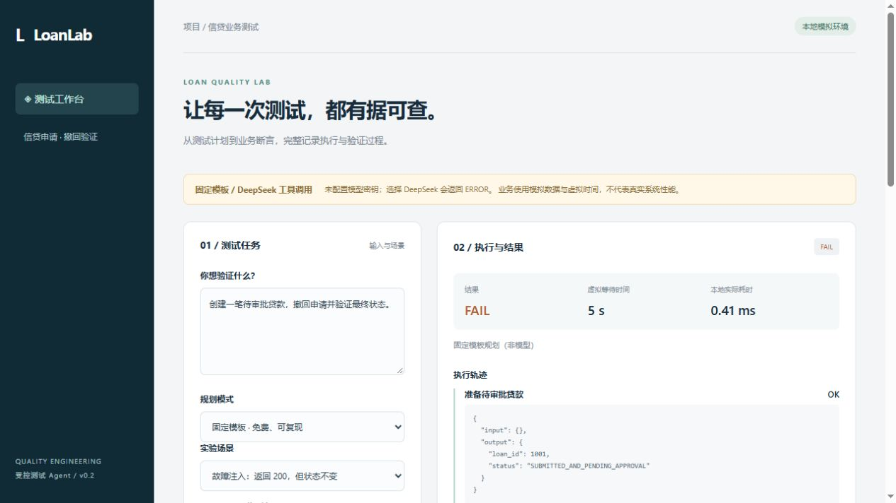

# LoanLab Test Agent

**面向信贷申请撤回场景的受控测试 Agent。** 将自然语言任务转为白名单工具调用，使用代码验证最终业务状态，保留执行轨迹与证据报告。

Python 3.12+ · 标准库运行 · DeepSeek 工具调用 · 无密钥可演示



## 解决什么问题

撤回接口返回 HTTP 200，不代表贷款已撤回。LoanLab 将“提交操作”和“验证状态”分开：创建隔离贷款 → 提交撤回 → 有界轮询 → 核对同一贷款最终状态。模型选择工具，代码决定业务结果。

业务参考 Apache Fineract 的贷款申请撤回流程。**当前版本使用内存模拟后端，尚未完成真实 Fineract 集成；这是个人工程项目，不是银行生产系统。** 仓库未包含 Fineract 源码。

## 三分钟运行

```sh
git clone https://github.com/Zthy1/loanlab-test-agent.git
cd loanlab-test-agent
python -m loanlab.server --port 8768
```

打开 http://127.0.0.1:8768 。默认“固定模板”模式无需模型密钥、无需安装第三方依赖。Python 命令在 Windows 上也可替换为 `py -3.12`。

1. 选择“正常撤回”：观察 PASS 和同一贷款 ID 的证据。
2. 选择“延迟 2 秒后生效”：观察虚拟时间 t=0、1、2 的查询。
3. 选择“返回 200，但状态不变”：观察 FAIL，HTTP 成功不会覆盖业务失败。
4. 选择“撤回后查询异常”：观察 ERROR；不能把依赖不可用直接当作已确认业务缺陷。
5. 下载 JSON 报告，核对执行轨迹、查询记录与代码诊断。

这里的 5 秒等待预算是**演示契约**，虚拟时间不代表接口实际 SLA；真实系统须按其文档设定预算和真实时钟。

## 使用真实 DeepSeek 模型

先在启动服务的终端配置环境变量，然后重启服务。不要把密钥写进代码、网页或 Git。应用不自动读取 `.env`。

PowerShell：

```powershell
$env:DEEPSEEK_API_KEY = '<在本机填写>'
python -m loanlab.server --port 8768
```

macOS / Linux：

```sh
export DEEPSEEK_API_KEY='<在本机填写>'
python -m loanlab.server --port 8768
```

页面选择 DeepSeek 模式会请求付费 API。官方模型 ID 为 `deepseek-flash`，对应版本以[服务商文档](https://api-docs.deepseek.com/)为准。默认关闭 thinking；每轮仅接受一个工具，最多 6 次模型请求，每次最多 1200 输出 Token、40 秒网络超时。**缺少密钥、限流或连接失败会显式报错，不会暗中切换为模板冒充模型运行。** 检测到密钥只表示已配置，不表示连通性验证成功。

## 核心设计

```text
任务 → 模板基线 / DeepSeek 工具调用
                  ↓
       工具名 + 参数 + 顺序 + 资源 ID 校验
                  ↓
     隔离模拟后端 → 代码轮询与业务断言
                  ↓
    PASS / FAIL / ERROR / REJECTED + JSON 证据
```

| 设计 | 实现与意义 |
| --- | --- |
| 业务断言独立 | 预期状态固定在代码中，模型不能通过修改预期让失败变成功 |
| 资源隔离 | 每轮独立后端；工具只允许操作本轮创建的贷款 |
| 有界执行 | 工具白名单、参数校验、调用上限、禁止重复撤回 |
| 最终一致性 | 轮询在首个成功状态停止，到期不满足预期判失败 |
| 结果分层 | 业务不符 FAIL、依赖异常 ERROR、不合规调用 REJECTED |
| 可回溯 | 模型工具决策、工具入参与输出、查询时间线和 Token 用量；不保存密钥及隐藏思考 |

## 验证

```sh
python -m unittest discover -s tests -v
python -m loanlab.evaluate --output reports/evaluation.json
```

测试包含状态转换、虚拟时间边界、假成功故障、依赖错误、资源越界、未知工具、重复写操作和模型提前结束。模型测试使用脚本响应替身，不消耗 API。5 个固定评测场景用于验证确定性契约，**不代表真实模型成功率或业务覆盖率**。GitHub Actions 配置为 Python 3.12 / 3.13，云端运行结果以仓库 Actions 为准。

## 源码入口

- `loanlab/agent.py`：受控模型工具循环与业务断言。
- `loanlab/model.py`：DeepSeek HTTP 客户端与调用限制。
- `loanlab/engine.py`：确定性模板与故障注入后端。
- `loanlab/server.py`、`loanlab/web/`：本地工作台、报告归档和下载。
- `tests/`：自动化契约与服务测试。
- [业务与面试说明](docs/business.md)、[项目边界与后续路线](docs/roadmap.md)。

## 当前边界

仅支持贷款申请撤回，不支持任意自然语言生成可执行脚本。没有真实银行数据、生产部署、权限系统或真实 Fineract 集成。服务仅监听本机，未实现登录，不应直接暴露公网。运行报告可能包含用户输入，默认不纳入 Git。发送给 DeepSeek 的任务和工具结果不要包含真实客户信息。

原创代码采用 MIT；Apache Fineract 是独立的 Apache-2.0 开源项目，参考版本与出处见业务说明。
